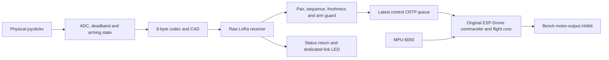

# ESP-Drone: 8-byte LoRa control with separate GPS telemetry

Prepared 2026-11-17. compact control plus independent NEO-6M reading and separate approximately 1 Hz GPS return packets. GPS does not enlarge the control frame.

## This full GPS version

Default pair ID is **0xff10**. `PROJECT_GPS_SUPPORT`, `GPS_ENABLED` and `GPS_TELEMETRY_ENABLED` are on. Receiver GPS UART reading and separate return packets are enabled, and the controller expects GPS health telemetry. Dedicated link LEDs retain the same steady-on/off meaning. Control packets remain exactly 8 bytes.

## What was replaced, and what still runs

This is a two-ESP32, point-to-point **raw LoRa** project, not LoRaWAN. Board 1 reads two joysticks and transmits commands. Board 2 is the ESP-Drone receiver: it accepts paired commands, reconstructs its original CRTP setpoint, and continues through the existing commander, estimator, controller/PID and mixer. MPU measurements describe the board's actual physical attitude; they do not follow stick commands on a motorless board.

The original Wi-Fi path uses UDP port 2390, a CRTP header, the 14-byte `<fffH` roll/pitch/yaw-rate/thrust payload, and a one-byte additive checksum: **16 UDP application bytes** for this command, before UDP/IP/Wi-Fi overhead. This LoRa path sends **8 application bytes**, including pairing and sequencing: a 50% reduction relative to that particular 16-byte UDP message. It uses radio payload CRC instead of the Wi-Fi sum8. It is a new compact wire format with an adapter, rather than transparent UDP forwarding.

The firmware is a **motorless bench build** (`CONFIG_WIFI_BENCH_NO_MOTORS=y`). Software setpoints and mixer values can change, but physical motor GPIO/PWM writes are inhibited. Both copied variants retain arming, kill and timeout behavior. Neither is flight-validated.

## Radio and scheduling

| Parameter | Setting |
|---|---|
| Transceiver | SX127x, version register observed as `0x12`; exact model not identified by that register |
| Carrier | 433,000,000 Hz |
| Modulation | SF7, 500 kHz bandwidth, coding rate 4/5 |
| Framing | Explicit header, payload CRC required, preamble 8 symbols, normal IQ |
| Sync word | `0x2d` |
| Transmit power | Driver register `0x09 = 0x80`, configured as 2 dBm PA_BOOST bench power |
| Stick/control schedule | 50 ms plus 0–3 ms jitter, approximately 19.4 Hz |
| Channel access | Up to 3 CAD attempts, randomized 2–6 ms backoff after a busy attempt |
| Return opportunities | Every fourth successfully transmitted control, approximately 4.8–5 Hz |
| Reply turnaround | Receiver waits 3 FreeRTOS milliseconds before starting its reply |
| Receiver control expiry | No accepted fresh control for **more than 300 ms** |
| Controller arm/link watchdog | Clears local arm request after 1 second without valid replies |

Each board owns its radio from one task. SPI IRQ flags are polled; DIO0 is not a source of blocking SPI interrupt work. The latest control overwrites an older pending control, rather than building a queue of stale commands. Optional diagnostics use bounded queues and can be dropped.

## Complete 8-byte control packet: 64 application bits

All four channels travel in each frame; there is no separate roll packet or yaw packet.

| Offset | Bits | Field and encoding |
|---|---:|---|
| 0–1 | 16 | Pair ID, unsigned little-endian |
| 2 | 8 | Sequence, increments modulo 256 for new control attempts |
| 3 | 8 | Type `0x10`; bit 0 ARM request, bit 1 KILL, bit 2 request reply; bit 3 reserved |
| 4 | 8 | Roll int8, 0.25 degrees/step; −128 reserved |
| 5 | 8 | Pitch int8, 0.25 degrees/step; −128 reserved |
| 6 | 8 | Yaw-rate int8, 2 degrees/second/step; −128 reserved |
| 7 | 8 | Throttle uint8 0–255; expanded to 0–60000 thrust units |

Sticks normally produce ±30° roll/pitch and ±180°/s yaw. The codec can represent ±31.75° and ±254°/s. Throttle quantization is about 235 thrust units per step. The receiver expands into three float32 values and one uint16 for CRTP port 3, channel 0. The stock RPYT decoder subsequently inverts yaw; positive wire yaw therefore appears as negative `set_yaw`. The controller already inverts pitch before encoding. Original thrust unlock/clamp rules remain downstream.

These 8 bytes do **not** include the LoRa preamble, physical header, FEC or CRC symbols. Packet addressing and sequencing are inside the 8 bytes; modem overhead is additional airtime.

### See the packets in the GPS bench capture

The receiver build selects `CONFIG_TRANSPORT_LORA=y`. The `comm` module installs that transport with `crtpSetLink(transportGetLink())`, and the LoRa adapter queues the legacy setpoint on CRTP port 3, channel 0. At startup the receiver prints `CRTP transport: paired-lora`.

One captured command used sequence 186 and applied **+8° roll**. The table shows the recorded LoRa bytes and the CRTP bytes reconstructed from the receiver's logged queue values using its little-endian `<fffH` layout.

| Stage | Size | Bytes in hex |
|---|---:|---|
| Controller `TX8` over LoRa | 8 bytes | `10 ff ba 11 20 00 00 00` |
| Receiver setpoint data | 14 bytes | `00 00 00 41 00 00 00 00 00 00 00 00 00 00` |
| CRTP header + setpoint data | 15 bytes | `30 00 00 00 41 00 00 00 00 00 00 00 00 00 00` |

The stock Wi-Fi UDP wrapper adds one checksum byte to those 15 CRTP bytes. With LoRa, the compact control crosses the radio and the receiver builds the same legacy CRTP layout locally. GPS travels in the opposite direction as its own 18-byte LoRa reply. See the [live monitor instructions](BUILD_AND_TEST.md#view-the-control-packet-and-gps-timing).

## Return traffic

An ordinary status reply is also **8 bytes / 64 bits**:

| Offset | Field |
|---|---|
| 0–1 | Pair ID |
| 2 | Echo of the control sequence opening this return slot |
| 3 | Type `0x20`; ready bit 0, armed bit 1, failsafe bit 2, bench/motor-inhibit bit 3 |
| 4 | Estimated MPU roll int8 whole degrees, clipped to ±127° |
| 5 | Estimated MPU pitch int8 whole degrees, clipped to ±127° |
| 6 | Last received control RSSI, int8 dBm |
| 7 | Last received control SNR, int8 quarter-dB units |

This is receiver status and recent return-path evidence. It is not a physical motor acknowledgement or proof that every control arrived. The reply can be sent before the CRTP dispatcher consumes the new queued setpoint. The compact status does not contain a standalone MPU-health flag; readiness and attitude are available, but explicit remote MPU freshness needs the GPS health flags or a future versioned status change.

The optional `0x30` CRTP tunnel is **5–35 bytes**, carrying pair(2), sequence(1), type(1), and original CRTP header/data(1–31). It supports sparse link/parameter/log services. Uplink tunnel use is disarmed-only; control ports 3, 7 and 8 are blocked there. Downlink uses existing return opportunities. Full GUI discovery/high-rate logging is not validated; verbose CRTP console data is dropped. Eight bytes describes ordinary control/status, not every optional diagnostic frame.

## Pairing, interference and freshness

The receiver requires the configured sync word, payload CRC, pair ID, packet type/length/channel bounds, and sequence progression. A forward sequence delta of 1–127 is accepted; duplicates and backward deltas are rejected and do not refresh control expiry. On a timed-out session, the next acquisition frame must be disarmed at zero throttle.

The two delivered pairs have distinct IDs, so each receiver filters packets by its configured pair ID. The IDs and sync word are **not cryptographic authentication, encryption or comprehensive replay protection**. Another transmitter on the same frequency still occupies the channel, even when its pair ID is different. CAD/jitter can reduce collisions but cannot guarantee coexistence or detect all hidden transmitters. A different pair ID does not create a separate RF channel.

## Arming, loss and the meaning of a green link LED

Keep both sticks centred during the first second of controller boot: it averages 100 ADC samples and applies a 6% normalized deadband. U1/bottom X is yaw, U1 Y is throttle; U2/top X/Y are roll/pitch. Centred throttle is zero and only the increasing-ADC half of travel raises throttle. Hold U1's button for 1000 ms at zero throttle, then release to arm/disarm. U2's button requests immediate kill/disarm.

An arm request is separate from receiver-confirmed arming. Controller throttle stays zero until a fresh ordinary status reply confirms arming. If fresh status still declines arming after 800 ms, the local request clears. Reception gaps over 300 ms disarm the receiver and inject a zero setpoint. The original command watchdogs remain underneath the transport guard. Link recovery does not automatically rearm; deliberately arm again at zero throttle.

A steady link LED means recent valid paired traffic, **not armed**. After a brief loss, the LED can recover while all applied setpoints remain zero. `input_roll/input_pitch/input_yaw/input_throttle` are decoded wire values; `set_*` are downstream ESP-Drone commands; `mpu_*` are measured attitude. Check those separately when diagnosing “the sticks do nothing.”

## GPS integration and its separate 18-byte packet

NEO-6M TX connects to ESP RX GPIO16 on UART2, 9600 baud, 8N1. GPIO17 is reserved for GPS RX but is not driven. A low-priority task reads UART, validates NMEA checksums, and parses GGA/RMC/GSV. It publishes a short locked snapshot via `gps_monitor_snapshot()` and the native `gps` log group. Radio code copies the latest snapshot; it never blocks waiting for UART or a satellite fix. GPS is not fused into the MPU estimator and does not implement navigation, position hold or return-to-home.

| Offset | Size | GPS type `0x40` layout |
|---|---:|---|
| 0–1 | 2 | Pair ID, little-endian |
| 2 | 1 | Echoed control sequence |
| 3 | 1 | `0x40` plus data-valid bit 0, fix bit 1, MPU-healthy bit 2, ready bit 3 |
| 4–7 | 4 | Latitude signed int32, degrees × 10^7, little-endian |
| 8–11 | 4 | Longitude signed int32, degrees × 10^7, little-endian |
| 12–13 | 2 | Altitude signed int16 metres, saturated |
| 14 | 1 | Satellites used |
| 15 | 1 | Satellites in view |
| 16–17 | 2 | Valid NMEA age, uint16 ms saturated at 65535 |

Total **18 bytes / 144 bits**, independent of the 8-byte control. GPS UTC remains local and is not returned in this packet. Decimal coordinate encoding is not an accuracy claim. Missing/stale data and a GPS with valid sentences but no fix are distinct states; valid data and fixes expire after 2.5 seconds, while the controller treats returned GPS telemetry as stale after 3 seconds.

At most one downlink is sent per requested reply opportunity. A GPS frame replaces an ordinary reply when its minimum 1000 ms period has elapsed. An ordinary status reply is prioritized once 400 ms have elapsed since the previous one; pending CRTP uses remaining opportunities. GPS return can therefore be delayed, and the receiver sends no unsolicited GPS transmission. This is latest-state best-effort telemetry, with no GPS acknowledgement/retry queue.

Compared with an 8-byte status return, a GPS frame adds **3.840 ms** of airtime at its opportunity, roughly **0.384 percentage points** of extra channel occupancy at exactly one return per second. It does not add 12.864 ms to every command. In the latest 20-second GPS-on phase there were 19 transmissions and 19 receptions; an earlier run had 20 transmissions and 18 receptions. GPS interval median was 1029 ms, maximum 1063 ms in the latest sample.

Receiver USB commands `GPS_RETURN 0` and `GPS_RETURN 1`, or native parameter `lora.gpsReturn`, toggle radio return only; local GPS reading continues. `CONFIG_GPS_ENABLED` and `CONFIG_GPS_TELEMETRY_ENABLED` control build behavior. The controller's `PROJECT_GPS_SUPPORT` setting must agree with the receiver's intended telemetry mode; intentionally stopping returns will correctly produce the controller's missing-GPS-return fault in this version.

## Latency, airtime and measurement limits

The symbol period at these settings is `2^7 / 500000 = 0.256 ms`. With explicit header, CRC and low-data-rate optimization off, the LoRa airtime calculation gives:

| Application payload | Calculated RF airtime |
|---|---:|
| 8-byte control or ordinary status | **9.024 ms** |
| 18-byte GPS return | **12.864 ms** |
| 35-byte maximum CRTP tunnel | **19.264 ms** |

`tools/airtime.py` reproduces the calculation. The formula is documented in the [Semtech-authored SX1276 reference driver](https://raw.githubusercontent.com/Lora-net/LoRaMac-node/master/src/radio/sx1276/sx1276.c); radio-family documentation is linked from [Semtech's SX1276 page](https://www.semtech.com/products/wireless-rf/lora-connect/sx1276).

**9.024 ms is not measured joystick-to-setpoint latency.** A stick movement first waits for the next sample/transmit opportunity (nominally up to about 53 ms), then CAD/backoff, transmission and receiver/commander scheduling. The actual observed longest control gaps were 74–76 ms in the short comparison. Packet loss can extend gaps further. There is no synchronized one-way latency measurement in the evidence, no worst-case latency guarantee, and no reason to divide RTT by two.

Historical bench timing, measured on the controller's own microsecond clock from radio TX start to parsing the matching reply:

| Quantity | GPS radio return OFF | GPS radio return ON |
|---|---:|---:|
| Control payload | 8 bytes | 8 bytes |
| Control rate | 19.351 Hz | 19.373 Hz |
| Control interval median / p95 | 52 / 53 ms | 51 / 53 ms |
| Longest observed interval | 76 ms | 74 ms |
| Ordinary status RTT median / p95 | **24.121 / 25.121 ms** | **24.121 / 31.121 ms** |
| Ordinary status RTT maximum | 48.121 ms | 44.129 ms |
| GPS reply RTT median / p95 | No GPS frames | **28.142 / 41.123 ms** |

Each phase lasted about 20 seconds. The OFF phase **still ran the local GPS task**; it only disabled GPS radio return. These are historical measurements of the integrated firmware, not newly measured timings of the split folders. The timing hashes identify the firmware used for that comparison. See [historical-timing.json](evidence/historical-timing.json), which retains timing-binary SHA-256 values.

The GPS-off path has shorter ordinary return packets than GPS return packets and showed a lower status-RTT p95 in that sample. Both phases had the **same median status RTT and the same control airtime**. Removing GPS is not evidence of a faster median control path. Historical Wi-Fi echo RTT was about 2.428 ms median in a different bench exercise; it is not a matched comparison, but it also prevents calling this LoRa conversion “faster than Wi-Fi.” Compression reduces application bytes; LoRa supplies a different radio link and tradeoffs.

A true end-to-end test should timestamp a joystick input event and the receiver's actual commander-consumption event on a shared clock, or toggle GPIOs captured on the same logic analyzer. Record distributions, loss rates and gaps under controlled distance/interference, keep PHY settings fixed, and report sample count/duration. USB arrival timestamps and independent board uptimes cannot substitute for synchronized one-way timestamps.

## Indoor paired-board run on 24 November 2026

The controller and drone streamed diagnostics over separate USB serial ports for 30 seconds. The drone was disarmed and reported valid GPS data with zero satellite-fix samples. The measured round trip starts when the controller transmits the request and ends when it receives the matching GPS reply.

| Measurement | Result |
| --- | --- |
| GPS replies received | 28 of 29 sent |
| GPS round trip | 28.142 ms median and p95, 28.161 ms max |
| Gap between GPS transmissions | 1.029 s median |
| Status round trip | 24.121 ms median |
| Drone control reception | 563 accepted, zero CRC errors and zero control timeouts across the sampled interval |

The run used the installed GPS firmware. It confirms the observed packet sizes and timing without identifying an exact firmware build hash. [Indoor bench results](evidence/indoor-gps-bench-20261124.json)

## Known faults, unresolved work and development directions

1. **Field-like RF instability is unresolved.** Historical 2026-11-13 logs contain repeated CRC failures and 300 ms control timeouts; received roll/pitch changed while the disarmed applied setpoints stayed zero. One saved 60-s window had 4 timeouts and 32 CRC errors; an earlier inspected window had 9 and 146. Those are different windows, not a reproducible range specification. RSSI around −104 to −117 dBm appeared during one weak-link window. The physical cause (distance, antenna, power supply, orientation or interference) was not isolated. The driver is still at 2 dBm bench power. Investigate hardware and collect paired TX/RX logs before tuning PHY/power.
2. **Link recovery is not arm recovery.** Re-arm deliberately at zero throttle. Do not “fix” this symptom by removing arming/kill/freshness checks or extending expiry until packet-loss behavior has been characterized.
3. **No flight/motor validation.** Motor outputs are inhibited. Current motor pin definitions are placeholders and boot-strapping/shared-pin constraints need review before enabling outputs. Keep the bench profile while validating communication.
4. **Timing evidence comes from short bench runs.** The installed GPS firmware was timed indoors. Range and one-way control latency remain unmeasured. Status replies can precede consumption by the original commander. Add an actual-consumption marker for meaningful end-to-end latency measurement.
5. **Addressing is not security or RF isolation.** Distinct pair IDs reject normal cross-pair packets but do not prevent interference or hostile injection. If the scope requires authentication, design a versioned protocol and budget the added bytes/airtime. An 8-bit sequence is a freshness heuristic, not a secure session counter.
6. **Diagnostics are coarse.** Receiver USB status is approximately 1 Hz, controller USB status 5 Hz, LED rendering every 25 ms. A brief loss and recovery can occur between USB lines; `timeouts` still increases. More serial output may affect timing. Host log event times are observation times, not exact RF event times.
7. **Serial reconnection needs work.** The dashboard can exit after USB loss and does not automatically reopen the port. The follower logger records missing serial data but cannot infer radio/sensor health while USB is silent. It does not store logs in ESP32 flash/SD.
8. **Sensor recovery is partially characterized.** MPU self-test/read freshness is not bypassed; local I²C startup includes bus recovery. Unplug/replug recovery during operation is not validated. Readiness depends on self-tests/calibration. An unplugged sensor and bad wiring/power/interrupts can produce the same missing-data indication.
9. **CRTP bandwidth is constrained.** Sparse diagnostics have been exercised; complete GUI TOC download and sustained high-rate log streams have not. Keep control priority and bounded queues.

Useful next steps are a reproducible paired-board loss/timing harness, antenna/power-supply checks, explicit disarm-reason telemetry, configurable radio settings shared by both builds, and a measured latency/range tradeoff matrix. Changing SF, bandwidth, coding rate or reply frequency changes airtime and may invalidate the 9.024 ms claim. Check local band/power requirements before changing RF settings; this report makes no regulatory compliance claim.

## Evidence and source navigation

- `evidence/historical-timing.json`: sanitized GPS-off/on bench distributions and original timing-binary hashes.
- `evidence/historical-measured.json`, `evidence/historical-hardware-summary.json`: original no-GPS-return link tests, including deliberately induced wrong-pair/replay/loss events. Their 6 induced timeouts are not 6 spontaneous baseline failures.
- `evidence/historical-link-led-summary.json`: both dedicated link GPIO masks off/on during silence/recovery; software GPIO observation, not an optical test.
- `evidence/field-command-diagnosis.json`: received-versus-applied command examples and weak-link diagnosis.
- `evidence/historical-wifi-reference.json`: separate Wi-Fi echo test reference, not directly comparable joystick latency.
- `variant.json` records the default branch configuration.
- `controller/main/controller.c`: sampling, deadband, button/arm confirmation, TX and matching replies.
- `components/lora_protocol/`: packet encoding, bounds, sequence/arm guard and expansion.
- `components/lora_radio/lora_radio.c`: actual register settings, SPI, CAD and radio polling.
- `components/core/crazyflie/hal/src/loralink.c`: prioritized transport queues, reply scheduling, status and expiry.
- `components/status_led/`: single-owner LED rendering and link deadlines.

Use [BUILD_AND_TEST.md](BUILD_AND_TEST.md) for commands. Upstream GPLv3 `LICENSE` and source notices are retained. The original project was based on Espressif ESP-Drone commit `9d5a4f85199ea056f40472b2248e10dcb6988b5c`; these packages include subsequent local changes.
